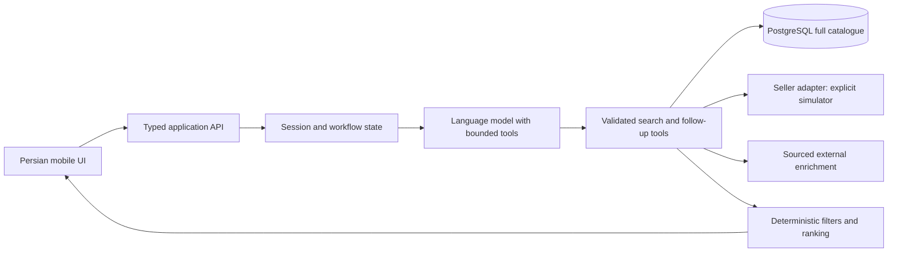

# Torob hackathon: competition plan

Prepared 22 October 2026 from the supplied challenge transcript and the actual v16 ZIP. The deadline and team size remain unspecified; the schedule assumes 48 elapsed hours and three workstreams. This is a proposed execution plan, not a claim that an app or its checks have been implemented. No plan can guarantee first place or 300/300.

Updated after reviewing the additional Liara training notes and mega-tool slide. See [training decisions](TRAINING-NOTES-DECISIONS.md) for the concrete integration design, sources and extra acceptance checks. These notes inform implementation choices; they do not change the supplied Torob rubric.

## 1. The bet

Build a Persian, mobile-first **in-person shopping copilot** that takes someone from an uncertain need to a practical store visit, and recovers when the first store fails.

Working promise: **«قبل از راه افتادن، انتخابت و وضعیت فروشگاه را بررسی کن؛ اگر نشد، جایگزینت آماده است.»**

The memorable feature is a **visit card**: exact product/variant, recorded versus checked price, evidence status, payment conditions, store location, declared hours, floor/unit when available, and a backup store. Simulated checks must remain clearly labelled. Do not promise guaranteed stock or a reservation.

One main journey must cover all four required steps:

1. Help choose a product using the customer's needs and a short comparison.
2. Find stores with actual joined offers for that product.
3. Compare stores by cost, distance, payment eligibility, and visit timing.
4. Follow up with sellers, handle failure, and prepare the visit.

Make general catalogue search work across the full dataset. Choose two data-rich categories for deeper guided advice and rehearsed demonstrations. Disclose that guided advice is deeper in those categories; do not pretend every category has equally complete specifications.

## 2. Optimize against the actual rubric

| Criterion | Points | What the judge should see | Release evidence |
|---|---:|---|---|
| Product | 75 | Need discovery → model comparison → sellers → follow-up → visit | One continuous journey plus direct product search |
| UX | 75 | Fluent Persian RTL, mobile layout, cards, editable filters, clear next actions | Browser checks on a phone-size viewport; no chat-only bottleneck |
| Intelligence | 50 | Appropriate clarification, seller failure, replacement, arrival-time constraints | Visible action timeline and changed recommendation after new evidence |
| Deployment | 40 | Working public HTTPS app with persisted sessions and stable data | Fresh browser, second network, restart and health checks |
| Technical | 40 | Typed tool contracts, grounded results, deterministic constraints, recovery | Focused tests, request traces, reproducible import |
| Dataset | 20 | Correct joins, honest missing data and provenance | Full row counts, integrity audit, source/time badges |
| **Total** | **300** | | |

Product + UX + intelligence account for 200/300 points. Allocate roughly 65% of build effort to the complete usable journey, 20% to deployment and reliability, and 15% to data validation and demo preparation. These are effort guidelines, not predicted marks. Deploy in the first quarter of the schedule.

## 3. Brief reconciliation and organizer questions

There is no demonstrated irreconcilable conflict between the organizer explanation and the written brief. Later clarifications resolve several apparent tensions:

| Issue | Resolution for implementation |
|---|---|
| Contact sellers, but every telephone number is fake | The later judge clarification explicitly permits mock contact. Implement a truthful simulator behind a replaceable contact adapter. |
| Product discovery versus store selection | The Q&A explicitly requires both. Neither can be omitted. |
| Use the supplied dataset versus external search | Search the dataset first; supplement with attributed external sources. Ignoring a suitable dataset result is penalized. |
| No match in the catalogue | Recommend a relevant shopping area with a map widget, as an area suggestion rather than confirmed inventory. |
| Rich fields described in the brief versus the exported CSV | Implement against actual CSV fields. Missing shop images, history, licences, and descriptions cannot be invented. |
| Prices described as from last week | The export date and each actual price-change timestamp have different meanings. Display the field's actual timestamp; a price-change date is not a last-stock-check date. |

Ask the organizer early, without blocking development:

- Share the original mandatory introduction video/link. Only a text account was supplied, so watching it remains an outstanding requirement.
- Confirm submission deadline/timezone, URL/repository requirements, and how long deployment must remain available.
- Confirm whether any contact fields may be shown publicly. Keep synthetic phone numbers non-dialable by default.
- Confirm whether any requirement or dataset revision supersedes the supplied transcript and v16 export.

Do not spend time asking whether mock contact is allowed: the supplied Q&A already answers that. The statement that names/phones are synthetic is supplied organizer metadata, not something this local audit can independently prove.

## 4. Scope and UX

### Required release

**Start:** two obvious entrances: «کمکم کن انتخاب کنم» and «مدلم را می‌دانم». Offer a few example intents but allow free text.

**Need discovery:** ask only questions that change the shortlist: use case, total budget in toman, important tradeoff, area, arrival time, and whether installments are mandatory. Ask one or two high-value questions per turn; let people skip unknown preferences. Store these preferences in a shared structured state used by both chat and controls.

**Product shortlist:** show three useful candidates with image fallback, price range from eligible recorded offers, relevant specifications, tradeoffs, and a short reason tied to the user's priorities. Include a side-by-side comparison. Clearly distinguish external review findings from a model's explanation of specifications. Never generate customer ratings or pretend to have tested the products.

**Store list/map:** synchronized cards and pins. Each card shows price in toman, distance type, declared hours/unknown status, payment evidence, price-change time, and a clear action. Editable area, radius, budget, desired arrival time, and installment filters update results without restarting the conversation.

**Contact:** «بررسی قیمت و موجودی» opens a follow-up timeline with bounded progress and cancel. In the submitted simulator, label the entry point, transcript, result and visit card **«پاسخ شبیه‌سازی‌شده فروشنده»**. A green real-world verification badge is never produced from a simulation.

**Recovery:** if the seller has no stock, does not answer, reports a changed price, or cannot serve the requested arrival time, the app explains the conflict and proposes the next eligible option. Preserve all hard constraints. If none exists, explain which constraint prevents a match and offer explicit changes.

**Visit card:** show product variant, selected shop, total price interpretation, evidence freshness, a map/navigation action, supplied address, and extracted mall/floor/unit with original text available. Include one backup. A refresh rechecks conditions before departure. State that checks do not reserve stock.

**Empty results:** first try transparent lexical expansion and category matching. Then show dataset limitations and a sourced area suggestion if available. «در این دیتاست پیدا نشد» is different from «در تهران وجود ندارد».

**Generative UI:** build registered, schema-validated components for clarification, product comparison, store results, check progress and visit plans. The agent selects the component and supplies evidence-backed data; application code owns rendering, eligible records and actions. This is the core UI approach. Use shadcn/ui if it accelerates the chosen React stack. Evaluate CopilotKit/AG-UI in a 60–90-minute initial spike; retain them only if a real connected card, filter edit, cancellation and refresh work. Keep the typed API/polling fallback. The detailed decisions and official sources are in [training decisions](TRAINING-NOTES-DECISIONS.md).

### Extra feature with the best return

Show a compact **“what changed”** strip after a follow-up: «گزینه اول پاسخ نداد؛ این فروشگاه با همان شرایط خرید جایگزین شد.» This makes agent behavior visible without exposing private reasoning. The event log contains actions, evidence and decisions, not chain-of-thought.

### Add only after the complete journey is stable

First evaluate push-to-talk user input with an editable Persian transcript and product-photo/screenshot input that returns real catalogue candidates for confirmation. These are the highest-priority enhancements from the additional notes. Keep them outside the core journey's critical path and timebox each thin implementation to about one hour initially. Invalid/ambiguous media must fall back to typed input and honest uncertainty.

Next consider a sourced review summary, saved/shareable visit card and natural voice playback for the simulated seller. Each must earn its place by improving the demo. External-review enrichment is more useful than decorative seller voice if the comparison remains weak. User voice input and seller voice playback are separate features.

### Cut first

Real telephony, WhatsApp automation, Instagram scraping, checkout, loans/credit scoring, accounts and login walls, multi-stop route optimization, indoor navigation, custom model training, all-catalogue embeddings, autonomous browser agents, and elaborate infrastructure. A floor/unit extracted from an address is useful; an invented indoor route is harmful.

## 5. Data and truth model

Read `dataset-audit.json` for measured coverage and `DATA-FINDINGS.md` for its implications. Preserve every supplied ID and the raw source values. CSV `null`, blank text, `[]`, and `{}` need deliberate handling; a missing payment field means unknown, not confirmed rejection.

Core records:

- `products`: supplied product identity, category, brand, model, specs, image URLs; normalized search text alongside raw values.
- `shops`: supplied identity, coordinates, address, raw payment options and weekly hours.
- `offers`: supplied offer identity and product/shop foreign keys, seller title, description, warranty, price in **toman**, last price-change timestamp.
- `sessions`: structured preferences, selected IDs, state version, progress.
- `verification_events`: offer/product/shop IDs, exact variant, requested arrival time, contact channel, result, captured price, observed time, source mode, and optional transcript evidence.
- `external_evidence`: URL, fetched time, matched product/store identity, supported claims, confidence/limitations. Keep separate from original records.

Use separate fields for `recorded_price_toman`, `last_price_changed_at`, `observed_price_toman`, `stock_status`, `observed_at`, and `source_mode`. Do not overwrite the supplied offer with a contact simulation.

Availability states should include `unknown`, `listed_offer`, `seller_reported_available`, `seller_reported_unavailable`, `no_response`, and `conflicting`. Source mode separately distinguishes dataset, external source, real contact, and simulation. “Listed” is not “available now.” A seller report remains a report, with a timestamp and no implied reservation.

Other nonnegotiable rules:

1. A shop is a seller of a specific product only through `offers.product_id → products.product_id` and `offers.shop_id → shops.shop_id`. Category evidence supports area discovery, not stock claims.
2. Compare exact variants carefully. Seller title/description may introduce colour, capacity, condition, warranty or bundle differences even under a base product. Flag ambiguous variants rather than presenting false like-for-like savings.
3. Normalize Persian/Arabic yeh and kaf, digits, diacritics, whitespace and ZWNJ for search. Preserve the original display title. Normalize aliases conservatively; model numbers must survive.
4. Parse prices exactly as decimal/integer monetary values. Do not use floating-point arithmetic for the implemented money layer. Reject malformed, nonpositive or implausible offers from “cheapest” ranking until reviewed.
5. Installments require recognized evidence for the requested service. Distinguish TorobPay in-person acceptance from seller-declared installment services. Do not imply customer eligibility, number of payments, interest, or equal cash/credit prices unless known.
6. Missing weekly hours means unknown. Handle split shifts, declared closure, midnight crossing and `Asia/Tehran`. Declared hours are not live confirmation. Check arrival time plus a proposed visit buffer, not only whether the store is open now.
7. Haversine distance is straight-line distance. Display it as such. Road travel time requires an actual routing result; if unavailable, show distance and unknown ETA. Do not invent traffic-aware arrival times.
8. Extract mall/floor/unit only from evidence, with the original address retained. For external store lookup, match real identity carefully: most names are synthetic, so a name-only web lookup can attach the wrong business.
9. Show data coverage limits: selectively sampled Tehran areas, only part of Torob's shops, and at most 300 products per shop. Absent offers do not establish absent stock.
10. External text is untrusted data. It cannot change system rules or trigger tool actions. Source matching and server-side validation remain necessary even when output follows a JSON schema.
11. Multiple offers can share a product/shop pair. Retain all offer IDs and variant evidence; never impose pair uniqueness. Count distinct shops when describing seller choice. The 300 cap concerns distinct products, not necessarily offer-row counts.

## 6. Architecture: small enough to finish

Default proposal: TypeScript web app with a single application backend, PostgreSQL, and a one-shot Python CSV importer. Use the team's familiar React framework; a Next.js implementation is a reasonable default if the team has no preference. Keep the agent on the server. Use a persistent database and an ordinary container deployment with HTTPS. Pin dependency and model versions after verifying account access.

Do not load the full CSV files into model context. Search structured data, return a small candidate set, and let the model help interpret needs and explain evidence. Keep exact matching, monetary calculations, radius checks, payment filtering and hour calculations in code.

Search in this order: exact product/model match → normalized lexical search with category/brand filters → alias expansion → optional semantic retrieval for vague intent. PostgreSQL search indexes and a small evaluated synonym layer are the starting point. Assess Persian matching against actual queries; do not assume default English full-text settings work. Add vector search only if measured failures justify it; shortlisted-candidate reranking is enough for the first release.

State progression:

`discover → shortlist_products → compare_products → shortlist_shops → verify → plan_visit`

Contact failures and changed conditions transition back to `shortlist_shops` with recorded reasons. Unresolved variant ambiguity returns to clarification. A direct-model request can enter at product matching. User edits invalidate only dependent state. Persist versioned state so delayed responses for an earlier budget/location cannot replace newer results.

Proposed bounded tool contracts:

| Tool | Required behavior |
|---|---|
| `search_products(query, filters, limit)` | Return real IDs, evidence fields and match type |
| `compare_products(product_ids, preferences)` | Return supported specification differences and unknowns |
| `find_offers(product_id, constraints)` | Join real offers/shops and apply hard constraints |
| `rank_offers(offer_ids, preferences, arrival_at)` | Code-owned score components and exclusion reasons |
| `start_seller_check(offer_id, variant, arrival_at, mode)` | Return a persisted job ID; never infer authorization for real contact |
| `get_seller_check(job_id)` | Return typed status, source mode, evidence and timestamp |
| `build_visit_plan(offer_id, backup_id, arrival_at)` | Revalidate IDs, constraints, evidence and visit feasibility |
| `suggest_shopping_area(category, location)` | Return area evidence and map coordinates, without stock claims |

These are proposed interfaces, not provider APIs. Share JSON schemas or TypeScript types between frontend, backend, mocks and tools. Use function calling for tool requests and structured output for UI payloads. OpenAI documents those two uses separately; schema compliance does not establish factual correctness. See [function calling](https://developers.openai.com/api/docs/guides/function-calling) and [structured outputs](https://developers.openai.com/api/docs/guides/structured-outputs).

The table is the internal service contract. Following the supplied mega-tool slide, an optional model-facing facade can group related actions into `catalogue`, `shopping_options` and `visit_plan`, while keeping check execution in `seller_check_start` and check reads in `seller_check_status`. Use action-specific validated schemas, concise evidence and no universal `execute` tool. Test tool selection before adopting the facade; fewer tool names do not establish better performance. Any future real contact must remain behind an explicit authorization boundary. See [training decisions](TRAINING-NOTES-DECISIONS.md) for schemas, event ownership and token terminology.

Bound tool attempts and duration. Initial targets: at most two product-query expansions, checks for at most three sellers per user action, no infinite retries, and cancellable follow-up jobs. A database-backed job with polling is sufficient; a separate queue service is unnecessary unless the team's existing stack already has one.

## 7. Ranking that a judge can understand

First apply hard constraints: actual product/variant evidence, budget interpretation, area/radius, explicitly mandatory payment service, and requested visit timing when required. An unknown attribute must not silently pass a mandatory known-value constraint. Show unknown-hour stores separately if the user permits verification.

Then present tradeoffs rather than an unexplained “AI score”: cheapest recorded, nearest, and best fit for the visit. A provisional internal weighted score can combine normalized price fit, distance, arrival feasibility and evidence freshness. Start with `0.35 price + 0.25 distance + 0.25 visit feasibility + 0.15 evidence`; tune using labeled examples. These weights are a starting hypothesis, not measured truth. Keep normalization consistent across a comparison and explain changes after filters.

Unknown information should lower evidence quality or cause exclusion where necessary; it should never create a bonus. Price-change age is a prompt to verify, not proof that the current price is incorrect. Keep the LLM out of arithmetic and final eligibility decisions.

After a failed check, rerun eligibility and ranking using the new evidence. A successful replacement should state the tradeoff: different price, farther away, different model, or changed payment terms. Changing product model requires a visible user choice when it changes the requested item.

## 8. Seller simulation that proves the real agent works

The simulator replaces the external seller boundary. Search, joins, constraints, ranking, state transitions and UI remain real application behavior.

Implement deterministic, resettable scenarios attached to actual offer IDs:

| Scenario | Response | Expected application behavior |
|---|---|---|
| Available | Price, variant and hours response | Produce a simulated checked visit card |
| No answer | Bounded timeout | Mark unknown; offer next eligible seller |
| No stock | Explicit seller response | Exclude this offer for this check and replan |
| Changed price | New amount | Recalculate budget; explain change; replan if needed |
| Closing soon | Cannot serve arrival | Avoid infeasible visit and explain why |
| Ambiguous variant | Cannot confirm requested variant | Ask a targeted clarification; avoid a false confirmation |

Store simulations in a separate fixture file/event table; never alter original dataset records to make a scenario work. Make the production demo's simulation status persistent and obvious. Include scenario controls in a separate demo/control view; the consumer journey should remain understandable on its own. If there is voice playback, it must match the displayed simulated transcript.

Real external browsing can still enrich product information or area recommendations. Keep its claims and citations distinct from the synthetic seller channel. Do not call supplied synthetic phone numbers.

## 9. Model choices, including Jev

Use one primary general model initially. Run a small Persian task evaluation before adding model routing. With unlimited budget, latency, availability and integration risk still matter.

For a concrete initial OpenAI experiment, compare `gpt-6.1-sol` with `gpt-6-astra` on the same cases. The current official catalogue positions Astra for the most demanding reasoning and Sol as the balanced option. My recommendation is to start with Sol for the interactive workflow and use Astra for difficult-case review only if evaluation shows a useful gain. This recommendation is a project hypothesis, not a measured Persian benchmark. [Official model catalogue](https://developers.openai.com/api/docs/models).

Benchmark any alternative provider already working in your environment on the same cases rather than adding an integration because of its reputation. Select by valid tool calls, grounded Persian answers, retrieval results, missed constraints, recovery success, and p50/p95 latency. Access to every model is not evidence that every model helps.

**Jev is optional and potentially useful for bounded judgments:** route an intent among fixed choices, assess candidate relevance, or flag whether an explanation is supported by supplied evidence. TypeSafe describes typed Choice/Score/Noul results and recommends atomic questions composed in code. It is not the component to write the Persian conversation or own the complete shopping workflow. [TypeSafe introduction](https://docs.typesafe.ai/introduction).

Do not interpret its `confidence` as the probability of real-world stock or guaranteed correctness. Its documentation defines confidence using the returned probability distribution; thresholds require local evaluation. Include `unknown`/`none` in suitable tasks, and validate against human labels. [Confidence documentation](https://docs.typesafe.ai/confidence).

Timebox Jev evaluation to 45–60 minutes after the full core journey works: compare 40 labeled Persian classification/relevance cases against the existing method, measuring quality and latency from the deployed server. Keep it only if it helps without a new failure mode. Pin the tested version. The 1.14 release describes image/long-context features as experimental; they are unnecessary for this plan. [TypeSafe release notes](https://typesafe.ai/blog/jev-1-14).

Voice, embeddings, rerankers and image understanding are task-specific options. Add them in response to an observed need. No fine-tuning or GPU infrastructure is needed for the proposed release.

## 10. Schedule and ownership

These are elapsed-time checkpoints with parallel workstreams, not 48 continuous hours per person. For two people, combine backend/data with integration and keep frontend/demo together. For one person, work in the same dependency order and cut optional enrichment/voice immediately.

| Window | Backend/data owner | UX/frontend owner | Integration/demo owner | Exit gate |
|---|---|---|---|---|
| 0–3h | Import, audit, normalize, indexes | Layout and shared card states | Freeze contracts, pick demo IDs, hosting | Real records visible in a thin UI |
| 3–8h | Search, joins, deterministic filters | Product comparison, store list/map | Deploy initial vertical slice; model tools | Public URL searches real dataset |
| 8–16h | Hours/payment logic and ranking | Editable preferences, comparison and empty states | Agent workflow and persisted sessions | Unknown need and exact-model journeys both work |
| 16–24h | Verification events, simulator outcomes | Contact timeline and visit card | Recovery and optional cited enrichment | Failure leads to eligible replacement |
| 24–32h | Fix data/constraint edge cases | Persian polish, mobile, loading/error states | Evaluation, second-network and restart checks | Required acceptance gates pass |
| 32–38h | Stabilize only | Fix usability blockers | Rehearse and record first complete video | Valid submission video exists |
| 38–44h | Release fixes and smoke checks | Demo polish only | Final narration, evidence, submission package | Public app and video verified |
| 44–48h | Buffer | Buffer | Submit early; verify receipt | Submission confirmed |

Training-note refinement: make the CopilotKit/AG-UI decision within hours 0–3, implement controlled components along the main UI work, and use at most hours 24–28 for thin voice/image enhancements only after core gates pass. Test these in hours 28–32 without taking time from recording or submission. If schedule or reliability suffers, remove the enhancements.

Critical dependency: contracts → real catalogue search → product/store journey → check outcomes → recovery → visit card → release verification → recorded presentation. Build this path before optional features.

If less than 24 hours remain: keep the full four-step flow, text-based mock contact, basic map/list, hard payment filters and deployment. Cut voice, semantic indexing, broad external reviews, image input and saved sharing. Reserve the final four hours for deployed testing, recording and submission.

If 72+ hours remain: spend the extra day on user testing, external review attribution, one genuinely useful enrichment flow, and failure handling. Add no feature until the existing release passes its gates.

## 11. Acceptance and evaluation

These are release targets to run during implementation; no app tests have been run as part of this planning work.

Prepare 40 labeled scenarios: 8 vague product needs, 8 exact model/variant queries, 6 location/budget edits, 6 payment constraints, 8 contact/arrival failures, and 4 missing-data/out-of-catalogue requests. Include Persian and Arabic character forms, mixed digits, “۲۰ تومن” ambiguity, typos and model aliases. Use actual offer IDs and expected eligible sets; keep a held-out portion for final checks.

Measure task success and individual invariants separately. Proposed gates:

- Import counts match all three CSV files; zero duplicate primary keys or broken foreign keys, or an explicitly documented quarantine for any discovered anomaly.
- Every suggested product/shop/offer ID resolves to supplied data or an explicitly identified external source. Zero fabricated IDs, prices, customer reviews or stock claims.
- Every hard-constraint check passes in the labeled cases. No quiet budget/radius/payment relaxation and no stale response replacing newer preferences.
- Exact product/model is in the top results for all exact known-model test cases; target at least 90% top-10 retrieval recall on labeled vague/alias cases. Diagnose misses before choosing an embedding model.
- Contact no-answer, no-stock, price-change, and closing-time cases reach the correct next state; unknown remains unknown, and simulation remains labelled throughout.
- Hours calculations handle Friday, split shifts, midnight and Tehran timezone; a closed/unknown store is not labelled confirmed open.
- Browser end-to-end coverage includes discovery, direct search, installment-only search, seller recovery and no-result area suggestion.
- Proposed performance targets: local indexed search p95 under 1 second; useful progress visible within 1 second; initial agent result p95 under 8 seconds on the selected test network. Measure these; if missed, simplify round trips and payloads. Do not disguise slow processing as a successful answer.
- Mobile at roughly 390px width: no horizontal overflow, readable RTL/Latin model names, usable filter controls, accessible buttons, image fallbacks and actionable errors. Check desktop as well.
- Fresh session, browser refresh and server restart preserve valid state. API timeout, image failure, map-provider failure and denied geolocation all have usable fallbacks. Manual area/pin entry must work.
- If voice/image input ships: verify editable transcript, ambiguous product matching, microphone denial, upload rejection, cancellation and no stale result after a filter change. Test the app's own screenshot/seller-text fixtures containing injected instructions; they cannot override constraints, expose credentials or authorize real contact. See [training decisions](TRAINING-NOTES-DECISIONS.md) for the proposed cases and upload limits.

Evaluate the complete application with deterministic assertions. A stronger model can critique explanations but cannot replace labeled constraints and expected outcomes. Maintain a short scorecard linking each rubric category to a visible screen, acceptance result and demo timestamp.

## 12. Deployment and judging-day reliability

Deploy a public HTTPS vertical slice early. Keep secrets server-side and data persistent. Supply a reproducible import command, pinned dependencies, health/readiness endpoint, error logs with request IDs, and a small README. A container plus persistent PostgreSQL is enough; use the team's proven hosting provider rather than learning an orchestration stack.

Verify model API reachability from the hosting region, and the actual app from intended user/judge networks. Verify map tiles, product images, fonts and navigation links from those networks too. Geography matters to this deployment; unlimited budget does not remove network dependencies.

Graceful degradation: if the model fails, preserve deterministic catalogue search, filters and existing visit data; if the map fails, preserve addresses/list; if external enrichment fails, preserve sourced dataset results. Do not present replayed contacts as new real seller replies. Keep the recorded video and a local working copy as contingency, alongside the required hosted app.

Before submission: verify URL, latest build, demo reset, session isolation, fresh-browser path, no exposed keys, video playback with audible Persian narration, file/link accessibility, and organizer receipt. Reserve time for the video: the supplied brief explicitly disqualifies submissions without it.

## 13. Five-minute presentation

Use live application interaction, readable mobile framing and clear Persian narration. The main scenario must be chosen from actual rows after checking geographic/payment feasibility. Any scenario responses are explicitly simulated, as permitted by the judges.

| Time | Screen/action | Point proven |
|---|---|---|
| 0:00–0:20 | One-sentence problem and promise | A wasted store visit is the problem |
| 0:20–1:05 | Vague need → targeted question → three product options | Product discovery and supported comparison |
| 1:05–1:50 | Choose model; edit area/budget/installments | Real catalogue joins and controllable UX |
| 1:50–2:50 | Compare stores; start labelled mock contact; first seller fails | Price freshness, follow-up and recovery |
| 2:50–3:35 | Eligible replacement; check arrival; show visit card | Complete in-person journey, floor/unit if supplied |
| 3:35–4:10 | Direct-model query and a no-match area suggestion | Both entry modes and incomplete catalogue handling |
| 4:10–4:40 | Show evidence timestamps, unknowns and deployed URL | Dataset honesty and operational app |
| 4:40–5:00 | State demonstrated outcome and current limitations | Clear product value and truthful scope |

Keep narration tied to what is visible. Do not use time to list models, show source code or present unmeasured money/time savings. Say “در این سناریوی شبیه‌سازی‌شده...” where appropriate. Record a complete acceptable take before polishing a second one.

## 14. Instructions to coding agents

Paste `AGENT-PROMPTS.md` into the respective coding sessions. These are bounded work packages, not permission to let multiple agents edit the same files freely. A human integration owner approves contract changes, resolves collisions and runs the complete journey. Use separate branches/worktrees if doing concurrent implementation.

The first practical move is **a deployed thin slice using the full dataset**, followed by the complete recovery journey. The main competitive advantage should be how well the app helps a person make and complete a visit.
